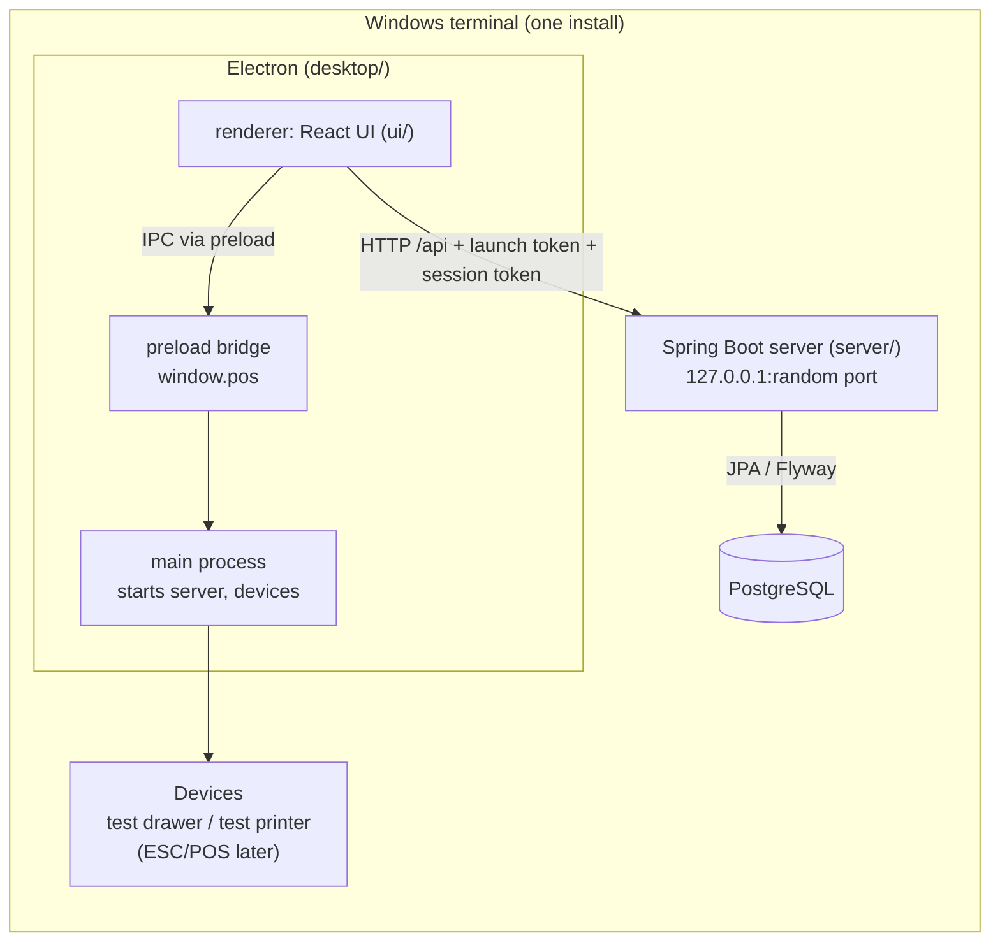
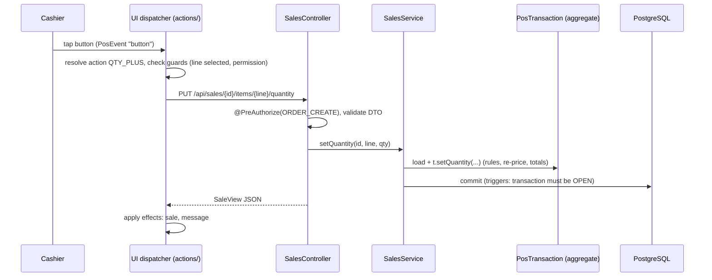
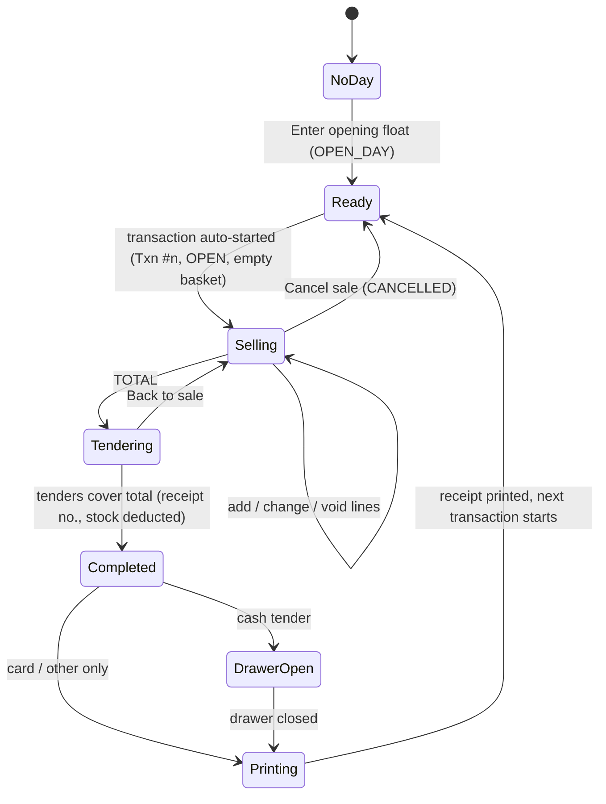
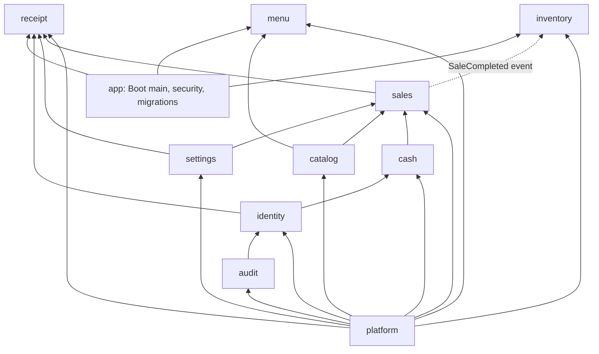

# Architecture and Process Flows

Start here to understand how a request moves through the system before adding a feature.
The step-by-step recipe is the `pos-feature` skill; feature specs live in [features/](features/).

## 0. Admin panel (separate app)
```
admin-ui (React) -> admin-app (Spring Boot, db pos_admin) <- till sync-client polls: packages (zip) down, transactions up
```
Shared jars keep master data identical; see [features/admin-sync.md](features/admin-sync.md).

## 1. System map

- The **UI never talks to devices or the DB directly**: devices via the preload bridge, data via the API.
- The **server owns all business rules** (totals, tax, permissions, what can change). The UI only shows results.
- The **DB enforces the hard rules** too (immutable finished sales, append-only ledgers, one open day).

## 2. One request, end to end
Example: the cashier taps **Qty +1** in the ITEM menu.


## 3. Sale lifecycle


## 4. Layers and where code goes
| Concern | Location | Rule |
|---|---|---|
| Table / constraint / seed | `server/app/src/main/resources/db/migration/V<n>__*.sql` | Never edit an applied migration |
| Business rule | Entity / aggregate method in its module (`server/modules/sales/.../PosTransaction`) | Throw `PosException` with a cashier-readable message |
| Use case / cross-feature coordination | `<feature>/<Feature>Service` | `@Transactional`; loads, calls aggregate, saves |
| HTTP API | `<feature>/<Feature>Controller` | DTO records, `@Valid`, `@PreAuthorize` |
| UI data access | `ui/src/features/<feature>/<feature>Api.ts` | Only through `api/client.ts` |
| Till button behaviour | `ui/src/features/sales/actions/*.ts` (`defineAction`) | Return effects; no store writes |
| Screen / component | `ui/src/features/<feature>/*.tsx` | CSS tokens only; works in every theme |
| Device (drawer, printer) | `desktop/src/devices/*` + preload + `ui/src/devices/devices.ts` | One IPC channel per device action |
| Visual theme | `ui/src/themes/<id>.css` + `app/theme.ts` | Never changes layout |

## 5. Server modules (Gradle)

Arrows point from a dependency to the module that uses it; the compiler enforces them (a module only sees what its
`build.gradle` declares). `inventory` reacts to the `SaleCompleted` event instead of sales calling it.
Code locations: `server/platform`, `server/modules/<name>`, `server/app`. Details: `pos-backend` skill.

## 6. Security in one paragraph
Electron starts the server with a random **launch token**; every `/api` call must carry it (`X-POS-Launch-Token`). PIN login returns a **session token** (`Authorization: Bearer`). Permissions are role-based (`role_permission`) and checked with `@PreAuthorize`; the UI greys out buttons using the same permission names from `pos_function.required_permission`.
