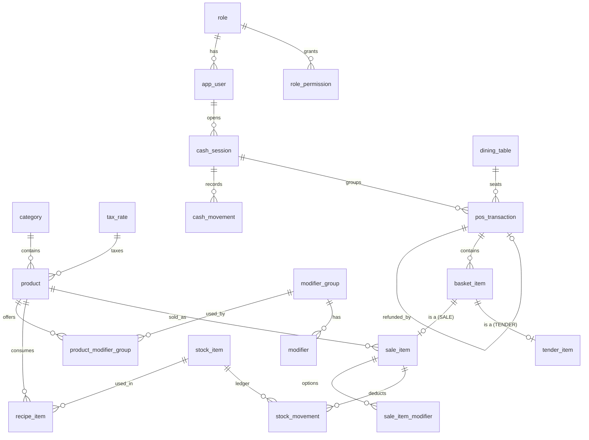

# Database Schema (single terminal, PostgreSQL)

DDL: [V1__init_schema.sql](../server/src/main/resources/db/migration/V1__init_schema.sql), seed data: [V2__seed_reference_data.sql](../server/src/main/resources/db/migration/V2__seed_reference_data.sql). Managed by Flyway; never edit an applied migration.

## Conventions
- PK = `uuid`, generated by the app as UUIDv7 (time-ordered; safe for future multi-terminal/cloud sync).
- Money = `bigint` minor units. Quantities = `numeric(12,3)`. Tax rates in basis points (1500 = 15%).
- Timestamps = `timestamptz` (UTC). `business_date` = `date` of the cash session.
- Enums = `text` + `CHECK` (easy to extend in a migration).
- Order lines snapshot name, price and tax so history survives catalog edits.
- Not yet included (add by migration when going multi-terminal/cloud): `tenant_id`/`outlet_id`, `device_id`, sync outbox.

## Sales model: transaction -> items

```
pos_transaction (SALE | REFUND)     one per sale; OPEN -> COMPLETED | CANCELLED; receipt_no + totals live here
  └─ basket_item (kind = SALE | TENDER)      the basket: one row per line (sale or tender)
       ├─ sale_item   (kind = SALE)               item_class = MERCHANDISE | NON_MERCHANDISE
       │    └─ sale_item_modifier                 modifiers belong to sale items only
       └─ tender_item (kind = TENDER)             method CASH | CARD | OTHER, tendered, change
```

There is no separate basket table. A transaction's **basket** is its set of `basket_item` rows, and the totals (subtotal, discount, tax, rounding, total) are columns on `pos_transaction`.

- **Sale item classes:** `MERCHANDISE` = physical goods/dishes, requires `product_id`, can be stock-tracked.
  `NON_MERCHANDISE` = service charge, delivery, tip, deposit, gift card, other; requires `non_merch_type`, no stock, `product_id` optional (ad-hoc charge).
- **Subtype integrity:** `sale_item`/`tender_item` carry a `kind` column with a composite FK to `basket_item(id, kind)`, so a SALE row can never get a tender subtype (and vice versa).
- **Refunds:** a `REFUND` transaction points to the original via `original_transaction_id` and needs a reason. Amounts are stored as positive magnitudes; views `v_sale_item_signed` and `v_tender_signed` negate REFUNDs so `SUM()` gives net figures. Only COMPLETED transactions appear in the views.
- **Cancel:** an abandoned OPEN transaction becomes `CANCELLED` (reason required, no receipt number consumed). Transactions are never deleted.

## ERD


## Tables
| Group | Tables | Notes |
|---|---|---|
| Config | `app_setting` | key/jsonb: business, receipt, printer, discount limits, license |
| Users | `role`, `role_permission`, `app_user` | PIN hash, lockout fields; permissions per role |
| Catalog | `tax_rate`, `category`, `product`, `modifier_group`, `modifier`, `product_modifier_group`, `dining_table` | `product.item_class`, `non_merch_type`, `track_stock` (merchandise only), `kitchen_print` |
| Inventory | `stock_item`, `recipe_item`, `stock_movement`, view `stock_on_hand` | Product-level stock = one recipe row, qty 1. Quantity is always derived from the ledger. |
| Day/cash | `cash_session`, `cash_movement` | One open session at a time; `z_report` jsonb snapshot at close |
| Sales | `pos_transaction`, `basket_item`, `sale_item`, `tender_item`, `sale_item_modifier`, `receipt_counter`, views `v_sale_item_signed`, `v_tender_signed` | See model above |
| Ops | `print_job`, `audit_log` | Print retry queue; audit of voids, discounts, adjustments, drawer opens |

## Integrity rules enforced in the DB (tested against Postgres 17)
- Only one `OPEN` cash session (partial unique index); one session per `business_date`.
- `cash_movement`, `stock_movement`, `audit_log` are **append-only** (UPDATE/DELETE trigger raises).
- A `pos_transaction` can only move OPEN -> COMPLETED/CANCELLED. Once not OPEN, it and its items, tenders and modifiers cannot be inserted, updated or deleted. Transactions can never be deleted.
- No new/changed transaction or cash movement against a `CLOSED` session (the day lock).
- COMPLETED needs `completed_at` + `receipt_no`; CANCELLED needs a reason and has no receipt number; REFUND needs `original_transaction_id` + reason.
- `sale_item`: MERCHANDISE needs `product_id`; NON_MERCHANDISE needs `non_merch_type`. `product.track_stock` only for MERCHANDISE.
- Stock `ADJUSTMENT`/`WASTE` need a `reason`.

## Enforced in the service layer (not the DB)
- Totals on `pos_transaction` and line amounts are computed in one place and must equal the sum of lines.
- Tenders must cover the basket total at completion; for cash, `change = tendered - amount`.
- `receipt_no` allocated from `receipt_counter` inside the completion transaction (gap-free per day).
- Stock deduction (`SALE` rows in `stock_movement`, MERCHANDISE only) in the same transaction as completion; `SALE_REVERSAL` rows when a REFUND restocks.
- A REFUND may not exceed what the original sale allows (items and tenders).
- Day close is refused while any transaction is still OPEN.
- Day-end expected cash = opening float + cash tenders (net of refunds, via `v_tender_signed`) + paid-in - paid-out - expenses.
- Permission checks per `role_permission`.

## Key queries (reporting)
- Daily sales: `v_sale_item_signed` grouped by `business_date`, split by `item_class`.
- Payment mix: `v_tender_signed` grouped by `method` (refunds negative).
- Item sales: `v_sale_item_signed` grouped by `product_id`.
- Low stock: `stock_on_hand WHERE low_stock`.

## Menus (V3-V5)
| Table | Notes |
|---|---|
| `pos_function` | Catalogue of built-in functions: `code`, `input` (NONE/NUMBER/AMOUNT/CONFIRM), `required_permission`, `needs_selected_line`, `available` |
| `menu` | `SALE`, `TENDER`, `ITEM` |
| `menu_folder` | Folder tree per menu; exactly one root (`parent_folder_id IS NULL`) per menu |
| `menu_button` | Slot `(folder_id, page, grid_row 0-3, grid_col 0-2)` is unique; `action_type` PRODUCT / OPEN_FOLDER / TENDER / FUNCTION / SWITCH_MENU, and CHECKs make each type fill exactly its own column(s) |

Behaviour of each button is defined in the UI action registry; see [sale-screen.md](sale-screen.md).

## V6
- `pos_transaction.txn_no`: sequence number shown from the moment a transaction starts (gaps allowed). `receipt_no` stays gap-free and is only set on completion.
- `receipt_template`: Mustache HTML receipt layout, `paper_width_mm`, one `active` row. See [receipts.md](receipts.md).
