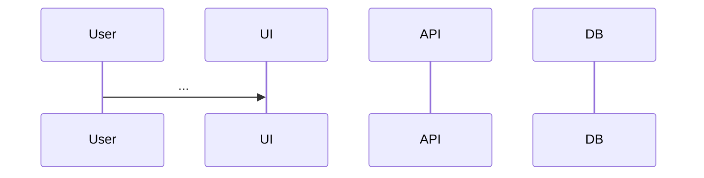

# Feature: <name>

> Copy this file to `docs/features/<kebab-name>.md` before building. Keep it short; it is the
> contract for humans and AI developers. Update it when behaviour changes.

## Why
One or two sentences: the problem and who has it (cashier, manager, owner).

## Flow

Or a numbered list of steps the user goes through.

## Rules
- Business rules and edge cases (what is allowed, what is refused and the message shown).

## Data
| Change | Detail |
|---|---|
| Migration | `V<n>__<desc>.sql`: new tables / columns / seed rows |
| Entities | new / changed classes |

## API
| Method | Path | Permission | Request | Response |
|---|---|---|---|---|

## UI
- Screens / components, actions (`defineAction` ids), menu buttons (`pos_function` codes), devices.

## Permissions
- Which `role_permission` values gate it; which roles get them (seed).

## Done when
- [ ] Server test (one flow test if money / stock / permissions change)
- [ ] Ran the app and checked the flow (screenshot via `tools/e2e`)
- [ ] Docs + skills updated, decision logged if a choice was made
