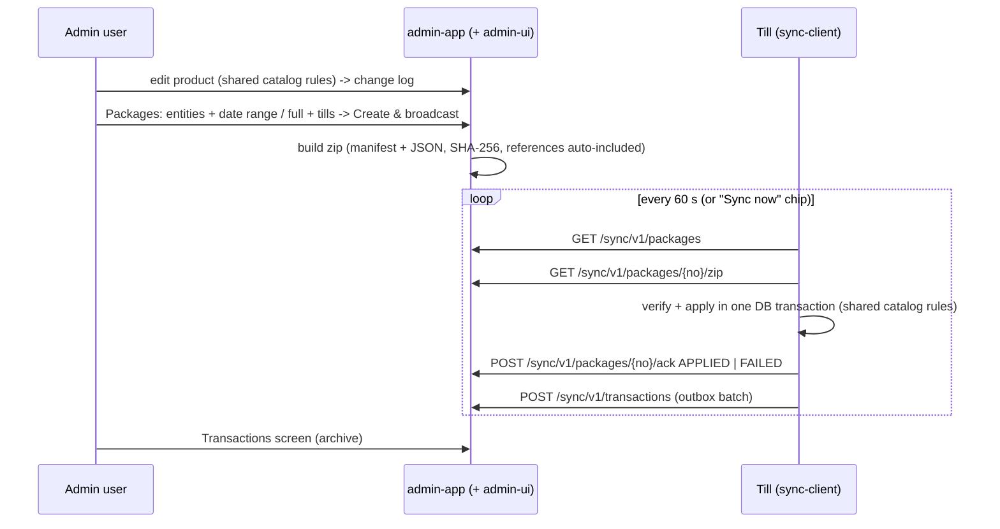

# Feature: Admin panel + configuration packages + transaction archive

## Why
Manage products and prices centrally, push them to tills reliably (also offline / several tills), and see
every till transaction in one place. Design and decisions: [../plans/admin-sync.md](../plans/admin-sync.md).

## Flow

## Rules
- Config is one-way. Deletes = deactivate. Packages hold full records; re-applying is harmless.
- A failed package stays waiting and is retried on the next check; the admin sees FAILED + reason per till.
- Every finished transaction (completed + cancelled) enters the till's outbox in the same DB transaction as the
  sale; uploads are idempotent by transaction id.
- Offline till: download the zip in admin, `POST /api/sync/import` on the till (SETTINGS_MANAGE).

## Data
Menus: `menu_folder` (+ `active`), `menu_button` (slot unique among active buttons), shared via `db/master` V13.
POS: `sync_state` (V10/V12), `txn_outbox` (V12). Admin: `admin_user`, `config_change`, `terminal` (V9),
`config_package`, `package_target`, `transaction_archive` (V11). Shared: master tables (V8 `db/master`).

## API
| Side | Method | Path | Auth |
|---|---|---|---|
| admin | GET/POST/PUT | `/admin/api/tax-rates`, `/categories`, `/products` | admin session |
| admin | GET/POST | `/admin/api/packages`, GET `/admin/api/packages/{no}/zip` | admin session |
| admin | GET/POST | `/admin/api/terminals` (token shown once) | admin session |
| admin | GET | `/admin/api/transactions?terminalId&from&to&q`, `/admin/api/transactions/{id}` | admin session |
| admin | GET | `/sync/v1/packages`, `/sync/v1/packages/{no}/zip`; POST `/ack`, `/sync/v1/transactions` | terminal token |
| POS | GET | `/api/sync/status`; POST `/api/sync/now`, `/api/sync/import` | session |

## UI
admin-ui shell: categorised side nav (Overview, Catalog, Till layout, Sync, Reports) + header with feature search.
- Dashboard: one card per entity (Tax rates, Categories, Products, Menus): pending changes, last broadcast, Broadcast
  (changes since its last package, or everything the first time) + Broadcast all changes; target till chips.
- Products / Categories / Tax rates: list + tabbed inspector; View / Edit / Delete icons (delete = deactivate).
- Menus: Sale / Tender / Item tabs, folder tree (add / rename / remove), page tabs, 4 x 3 grid, button inspector
  (Action: product / folder / tender / function / switch menu; Label & look).
- Packages: New package (entities, date range or snapshot, tills) / History tabs. Terminals, Transactions.
POS header: sync chip (tap = sync now).

## Tests
`admin-app/AdminSyncFlowTest` (package round trip, auto-included references, ack, idempotent archive),
`app/PackageSyncTest` (apply, tamper rejected, outbox). Verified end to end locally: admin price change -> package
-> till applied in 5 s -> sale + cancel archived.
