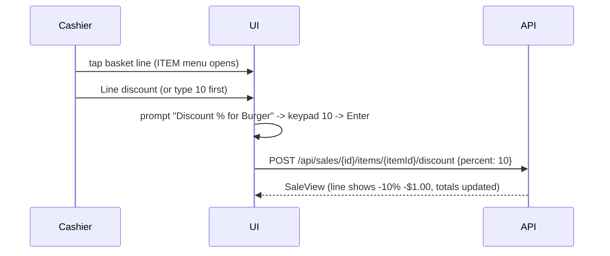

# Feature: Line discount

## Why
Cashiers need to take a percentage off one item (staff meal, damaged item, promotion) without
voiding and re-entering it; bigger discounts need a manager.

## Flow

## Rules
- Whole percent 0-100; `0` removes the discount. One discount per line (a new one replaces the old).
- Up to `app_setting.discount.cashierMaxPercent` (default 10) for anyone with ORDER_CREATE; above it needs `DISCOUNT_UNLIMITED` (Manager, Owner). Refused: "Discounts over 10% need a manager."
- The percent is stored on the line, so changing the quantity re-calculates the discount.
- discount = round_half_up((unit price + modifiers) x qty x percent / 100); tax is calculated on the discounted amount.
- Only on item lines of an OPEN sale. Every change is audited (`LINE_DISCOUNT`, with percent and amount).

## Data
| Change | Detail |
|---|---|
| Migration | `V7__line_discount.sql`: `sale_item.discount_bp` (basis points), `pos_function LINE_DISCOUNT` available, receipt template shows discounts |
| Entities | `SaleItem.discountBp` + `applyDiscount`; `PosTransaction.discountLine` |

## API
| Method | Path | Permission | Request | Response |
|---|---|---|---|---|
| POST | `/api/sales/{id}/items/{itemId}/discount` | ORDER_CREATE (+ DISCOUNT_UNLIMITED above the cashier limit) | `{ "percent": 10 }` | SaleView |

## UI
- Action `LINE_DISCOUNT` (`actions/line.ts`): needs a selected item line, asks for a number.
- Basket line shows `-10% · -$1.00`; receipt shows a discount row under the item.

## Permissions
`ORDER_CREATE` (all roles) up to the limit; `DISCOUNT_UNLIMITED` (Manager, Owner, seeded in V2) above it.

## Done when
- [x] Server test: `sales/LineDiscountTest` (cashier within limit, cashier over limit refused, manager over limit, qty change keeps percent)
- [x] Ran the app: `tools/e2e/line-discount.mjs`
- [x] Docs: this spec, features index, sale-screen action table, receipt placeholders, decision D-017
