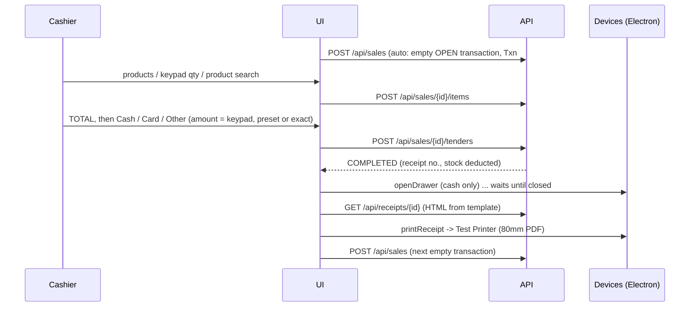

# Feature: Sale cycle

## Why
The core till loop: always ready for the next customer, every sale ends with the drawer closed and a receipt.

## Flow

## Rules
- One OPEN transaction per user per open day; it is reused until completed or cancelled.
- Cash may exceed the amount due (change); card/other may not.
- Completion assigns a gap-free receipt number and deducts recipe stock in the same DB transaction.
- While finishing (drawer / printing) the till is BUSY and ignores presses.
- A print failure does not undo the sale; the message says the receipt did not print.

## Data
`pos_transaction` (+ `txn_no`), `basket_item` -> `sale_item` / `tender_item`, `receipt_counter`, `stock_movement`, `receipt_template`.

## API
`/api/sales` (start, current), `/api/sales/{id}/items`, `/quantity`, `/order-type`, `/tenders`, `/cancel`, `/api/receipts/{id}`.

## UI
`features/sales/`: `SaleScreen`, `useAutoTransaction`, actions (`PRODUCT`, `TENDER`, `TOTAL`, line actions), dispatcher `finishSale`; devices in `ui/src/devices/`.

## Tests
`sales/SaleFlowTest` (cash sale -> change, receipt no., stock, receipt HTML). UI flow checked with `tools/e2e/sale-cycle.mjs`.
