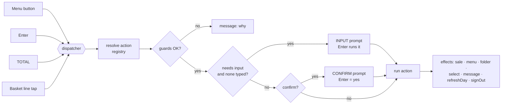
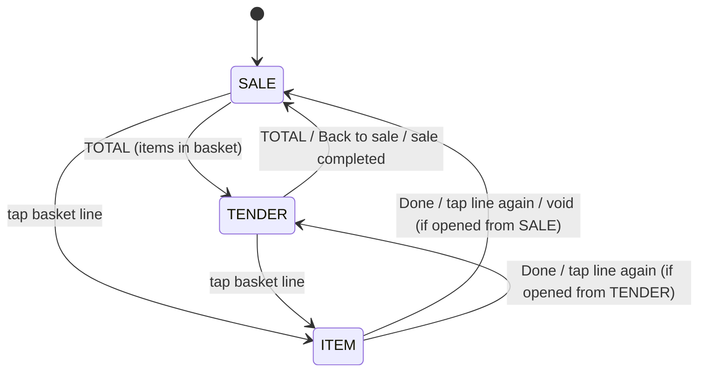

# Sale Screen: Layout, Menus and Actions

## Layout (1366 x 768 target)
```
┌ header: business · day · sale status ··············· theme · user · sign out · clock ┐
├─────────────────────────────────────────────┬───────────────────────────────────────┤
│ BASKET (60%)                                │ READOUT: prompt / value / message     │
│  #  Item                    Qty    Amount   │ KEYPAD   7 8 9 ⌫                      │
│  1  Burger                   1      10.00   │          4 5 6 Clear                  │
│  2  Cola                     2       5.00   │  (50%)   1 2 3 Enter                  │
│  ── Payments ──                             │          0   00 Enter                 │
│  3  Cash                           -15.00   ├───────────────────────────────────────┤
│                                             │ MENU: Sale › Mains        ‹ Back Home │
│  Subtotal / Tax included / Paid             │  [Burger] [Ch.Burger] [Fried Rice]    │
├─────────────────────────────────────────────┤  [Noodles] [      ]   [          ]    │
│ TOTAL                               15.00   │  (50%) 4 rows x 3 columns per page    │
└─────────────────────────────────────────────┴───────────────────────────────────────┘
```
Default theme: flat white/grey surfaces separated by 1px lines; blue for actions (Enter, TOTAL, tenders, folders).
Other themes (header picker): Dark, and Liquid Glass (frosted floating panels, glossy rounded buttons). Same layout in every theme.

## Event flow


## Menus

Each menu is a folder tree (`menu` -> `menu_folder` -> `menu_button`); every folder page is a 4 x 3 grid.

## Dialog modes
| Mode | Prompt shows | Enter | Clear |
|---|---|---|---|
| IDLE | hint for the current menu | opens the day if not open | clears keypad |
| INPUT | e.g. "New quantity for Cola" | runs the action with the typed number | cancels |
| CONFIRM | e.g. "Void line 2 (Cola)?" | runs the action | cancels |

## Actions
| id | Trigger | Needs | Input / confirm | Effect |
|---|---|---|---|---|
| PRODUCT | product button | day | keypad = qty (default 1) | starts sale if needed, adds line |
| OPEN_FOLDER | folder button | - | - | shows folder |
| SWITCH_MENU | e.g. Back to sale | - | - | switches menu |
| TOTAL | TOTAL button | items | - | SALE <-> TENDER |
| SELECT_LINE | basket line | sale | - | selects line, ITEM menu |
| DESELECT_LINE | Done | - | - | back to previous menu |
| QTY | Set qty | SALE line | number | sets quantity |
| QTY_PLUS / QTY_MINUS | Qty +1 / -1 | SALE line | - | changes quantity (min 1) |
| LINE_DISCOUNT | Line discount | SALE line (ORDER_CREATE; over cashier limit needs DISCOUNT_UNLIMITED) | number = whole % (0 removes) | discounts the line, totals and tax re-calculated |
| VOID_LINE | Void line | any line | confirm | removes line |
| TENDER | Cash / Card / Other / presets | sale, items | keypad = amount, else preset, else exact | adds payment; when paid: drawer (cash) -> wait for close -> receipt -> next transaction |
| TAKEAWAY_TOGGLE | Dine in / Takeaway | day | - | toggles order type |
| CANCEL_TXN | Cancel sale | sale, ORDER_VOID | confirm | cancels sale |
| OPEN_DRAWER | Open drawer | DRAWER_OPEN | - | opens the (test) drawer, waits for close |
| OPEN_DAY | Enter with no day open | - | keypad = float | opens cash session |
| SIGN_OUT | Sign out | - | - | ends session |
| (event) product | Product search result | day | keypad = qty | same as PRODUCT |

Listed but not implemented (`pos_function.available = false`, shown greyed): PRICE_OVERRIDE, TXN_DISCOUNT, SET_TABLE, HOLD_TXN, RECALL_TXN, REFUND, REPRINT, PAID_IN, PAID_OUT.

How to add one: see the `pos-sale-actions` skill.
